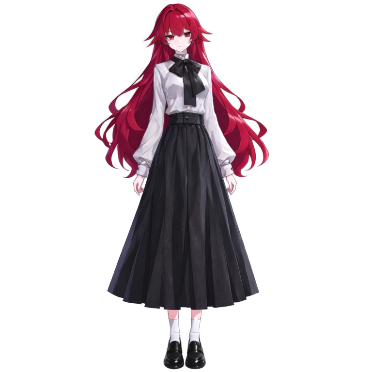

# Live2D Rigging Pack — Raw Asset

  

This is a raw PSD + PNG asset pack, fully organized and ready for the Live2D rigging process. The standard canvas size is **768 × 768 px**, consisting of a total of **23 layers** neatly split into **12 folders (Parts)**.

---

## 🎨 Rigging & Character Design Services (Kevsoft Services)

> **Need a custom model or want a ready-to-go setup without dealing with the hassle of rigging?**  
> We at **Kevsoft** also provide professional services for:
> - 🖌️ **VTuber / Live2D Character Design & Illustration** (Layer-cut / *rig-ready*)
> - ⚙️ **Live2D Rigging Services** (Smooth physics, custom expressions, up to full-body rigging)
> 
> 📩 **Reach out via Telegram:** [t.me/kevsoft_dev](https://t.me/kevsoft_dev) for consultations, orders, or commission info!

---

## 📦 Package Contents

| File / Folder | Function |
|---|---|
| `model_live2d.psd` | Main PSD file ready to be imported directly into Live2D Cubism. All layer/folder names are clean, Normal 100% blend mode, consisting of 12 Parts & 23 layers. |
| `layers/NN_Part_xxx/NN_Nama.png` | Individual PNG layers with full canvas size (positions already aligned, just stack them). The numbers at the front indicate the layer order (`01` = front-most). |
| `layers.json` | Layer data notes (new name, original name, folder, order, bounding box position, and dimensions). |
| `preview.png` | Composite image of all layers combined with a transparent background. |

---

  

## 🛠️ How to Use in Cubism Editor

1. Open Cubism Editor, select **`File → Open`**, then load **`model_live2d.psd`**. The layers will automatically convert into ArtMeshes and folders into Parts.
2. **Set up Clipping Masks** for the eyes so the irises don't bleed outside the whites of the eyes:
   * `Iris_L` → clipped to `EyeWhite_L`
   * `Iris_R` → clipped to `EyeWhite_R`
3. Generate Auto Meshes, then start the rigging process per Part. Here is a guide to standard parameters you can use:

| Part / Section | Common Parameters |
|---|---|
| `Part_HairFront`, `Part_Face`, `Part_EarsAccessory`, `Part_Brows` | `ParamAngleX`, `ParamAngleY`, `ParamAngleZ` (follows head movement) |
| `Part_Brows` | `ParamBrowLY`, `ParamBrowRY` |
| `Part_EyeL`, `Part_EyeR` | `ParamEyeLOpen`, `ParamEyeROpen` (eyelashes & eye whites), `ParamEyeBallX`, `ParamEyeBallY` (iris) |
| `Part_Mouth` | `ParamMouthOpenY`, `ParamMouthForm` |
| `Part_Body`, `Part_Arms`, `Part_Legs` | `ParamBodyAngleX`, `ParamBodyAngleY`, `ParamBodyAngleZ`, `ParamBreath` |
| `Part_HairFront`, `Part_HairBack` | Physics setup (`ParamHairFront`, `ParamHairSide`, `ParamHairBack`) |

---

## 📑 Layer Order (Front → Back)

`Hair_Front` → `Eyebrow_L/R` → `Eyelash` / `Iris` / `EyeWhite` (Left, then Right) → `Mouth` → `Nose` → `Face` → `Headwear`, `Ear_L/R` → `Topwear`, `Bottomwear`, `Neck` → `Shoes`, `Legs` → `Arm_L/R` → `Hair_Back`

> **Side Convention Note:**  
> The `_L` tag refers to the **character's left side** (appearing on the **right** side of your screen). Conversely, `_R` refers to the **character's right side** (appearing on the **left** side of your screen). If tracking looks reversed during testing, just swap the `ParamEyeLOpen` ↔ `ParamEyeROpen` parameters.

---

## 🔄 Changes from the Original PSD

* **Removed Layer Masks:** Native masks from the original file were stripped out because they caused double-alpha issues that made edges look faded.
* **Fixed Layer Hierarchy:** Eyelashes were moved above the iris and eye whites, and eyebrows were moved above the face (still below the bangs) to suit proper rigging workflows.
* **Standardized Naming:** Layer names were converted to clean, unique ASCII formats to prevent errors during import:
  * `front hair` → `Hair_Front`
  * `irides-l` → `Iris_L`
  * `handwear-l` → `Arm_L`
  * `footwear` → `Shoes`
* **Pixel Integrity:** Every layer's pixels are guaranteed 100% identical to the original assets with no cropping or image alterations.

---

## ⚠️ Important Notes Before Rigging

* **Low Resolution:** Component sizes are relatively small (Face: 68×61 px, Mouth: 8×5 px, Nose: 8×7 px, Iris: 12×9 px). It's still fully riggable, but there's a risk of blurriness when zooming in. It is recommended to 4× upscale (using Real-ESRGAN / waifu2x) and adjust the PSD canvas size before starting your rigging.
* **Expression Variations:** No spare layers are included for wide-open mouths, closed eyes, or other shape variants. Open/close motions will need to be handled via warping/deforming or drawing extra layers manually.
* **Elements Hidden by Bangs:** Eyebrows and `Headwear` are covered by the bangs in the original illustration. The layers are still there and can be rigged, but they'll only become visible if the bangs move or are toggled transparent.
* **File Verification:** The PSD structure has been verified both mathematically and programmatically. If you run into any issues loading it into Cubism Editor, hit up our tech team on Telegram.

---

  <b>Developed & Processed by Kevsoft</b> 
  <i>Providing Professional Character Design & Live2D Rigging Services</i> 
  📩 Contact: <a href="https://t.me/kevsoft_dev">t.me/kevsoft_dev</a>

